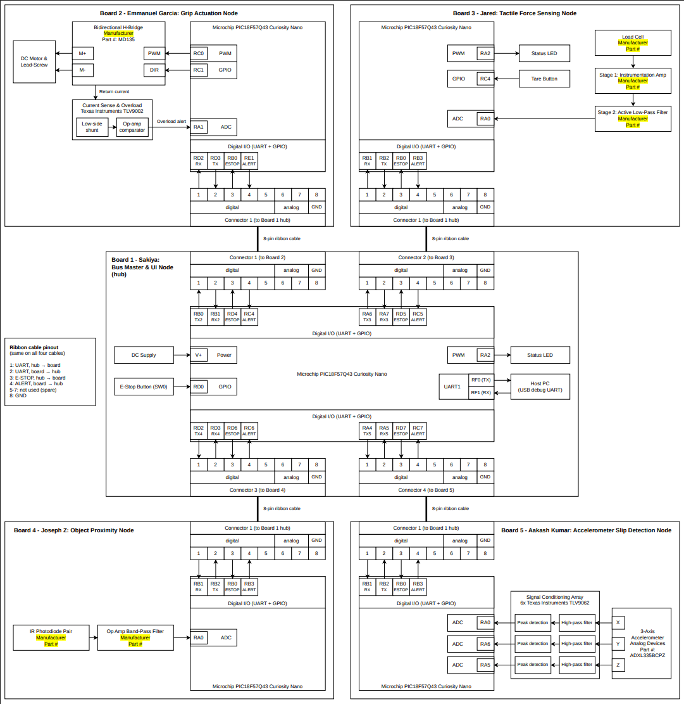

## Design Decisions

**Hub-and-spoke topology.** Board 1 is the only board that talks to every other board. This keeps the system's decision-making in one place, lets each teammate develop and test a node independently, and means a fault in one node cannot corrupt the others.

**One function per board.** The nodes are split by job: Board 2 actuates the grip, and Boards 3, 4 and 5 sense force, proximity and slip. Because all boards use the same MCU and the same 8-pin connector, any node can be swapped or debugged without changing the hub's hardware.

**Dedicated UART per node instead of a shared bus.** The hub has four UART peripherals, so one per connector. This avoids addressing, arbitration and collision handling, and each node only needs one simple serial port.

**Hardwired safety lines.** Each ribbon cable carries a discrete E-STOP (hub to node) and ALERT (node to hub) line next to the UART. Safety and urgent events therefore do not depend on software or serial traffic. Board 2 also has a hardware overload comparator on the motor current, so motor protection does not depend on the hub.

**Analog conditioning at the edge.** Each sensing node amplifies and filters its own signal before the ADC, so only digital data crosses the cable. Each filter matches its signal:
- FSR Sensor (Board 3): instrumentation amp plus low-pass filter for a small, slow signal.
- IR proximity (Board 4): band-pass filter to reject ambient light.
- Accelerometer (Board 5): high-pass filter plus peak detection per axis, so the ADC samples an envelope instead of a fast waveform.

**Our Cabling.** The 8-pin ribbon carries UART (pins 1-2), E-STOP (3), ALERT (4) and ground (8), with pins 5-7 spare for future needs such as a power rail or sync line.

## Images

  

The Block Diagram as a PDF download is available [*here*](image/team-block-diagram.pdf)
  
