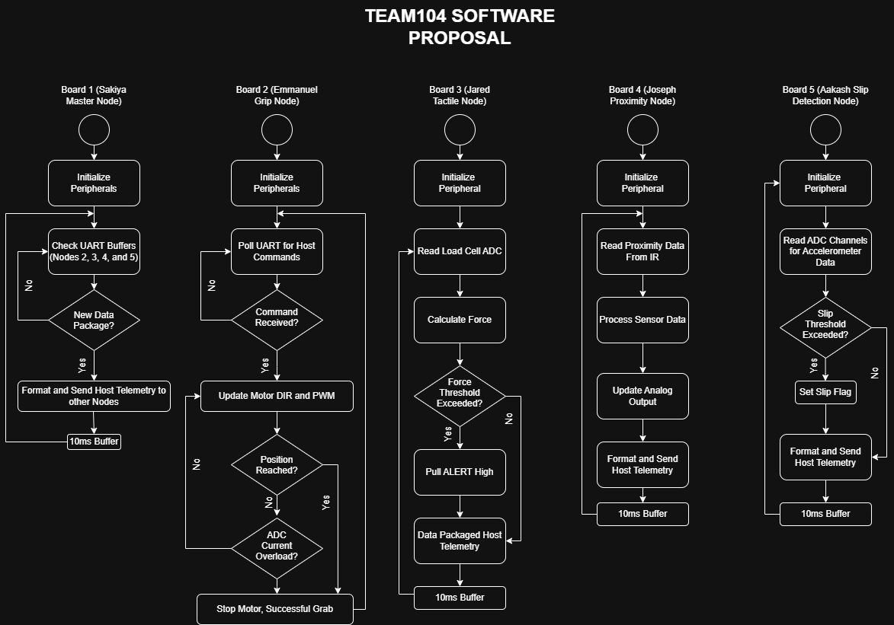

## Decision-Making Process

We gave each board its own flowchart because each node runs independently and communicates only through a shared UART message format. This lets each teammate develop and test a node on its own. Every board follows the same structure: initialize, then loop through read, decide, report and a short fixed delay. This keeps timing predictable and the code easy to review.

Sensor nodes measure and report, with thresholds applied next to the signal they belong to. The actuator node responds to commands and protects itself from overload. The hub polls the node UART links and routes data, matching the one-UART-per-node hardware.

## How the Software Meets Product Requirements

| Requirement | How the software meets it |
|---|---|
| [Sense grip force] | Board 3 reads the FSR force data, filters the analog out and reports it |
| [Detect object proximity] | Board 4 reads and processes the IR signal and reports it |
| [Detect slip] | Board 5 samples the accelerometer axes and flags slip past a threshold |
| [Control grip strength] | Board 2 sets motor direction and PWM from hub commands |
| [Protect the motor and object] | Board 2 monitors current for overload; Board 3 raises ALERT on high force |
| [Report status] | Board 1 formats and forwards telemetry to the host PC |
## Flowcharts

{width=800px}
**Figure 1:** Complete software execution flow and polling loops for the Smart Gripper subsystem nodes.
